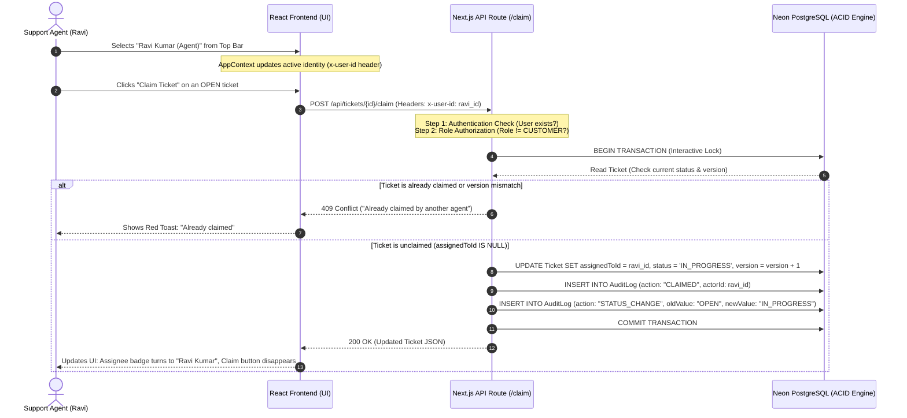
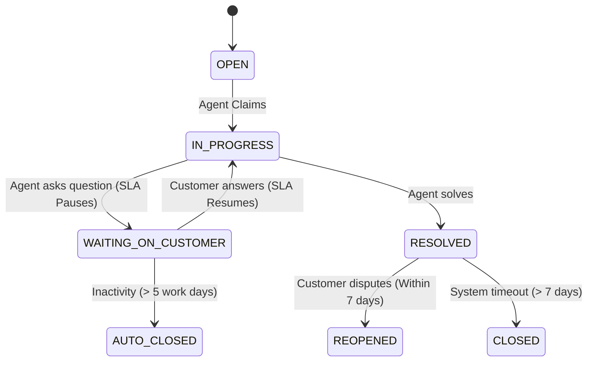

# Frontdesk — Architecture & Engineering Guide

This guide breaks down the architecture of **Frontdesk** from two complementary perspectives:
1. **The Engineering Deep-Dive**: Theoretical foundations, concurrency models, data isolation, and tech stack rationale.
2. **The Plain-English / Non-Technical Analogy**: Real-world mental models you can use to explain how this system works to non-technical stakeholders, managers, or interviewers.

---

## 1. The Real-World Journey: From User Selection to Ticket Claim

Let's follow the exact sequence of events when an agent steps up to claim an open ticket.



---

### The Plain-English Explanation (For Anyone)
> *Imagine a physical pegboard at an office with paper work orders hanging on hooks. In the old system, two workers could walk up to the board, grab the exact same sheet at the same second, and both start doing the job without knowing about the other.*
>
> *In our new system, the board is behind a glass window with a single clerk. When Worker A asks for Ticket #5, the clerk hands it over, writes Worker A's name in ink on the permanent logbook, and takes it off the hook. If Worker B asks for Ticket #5 two seconds later (or even two milliseconds later), the clerk says: "Sorry, Ravi already took that one."*

---

### The Developer Deep-Dive (Technical & Theoretical)

1. **Identity Injection (`x-user-id`)**:
   - The frontend maintains client state in `UserContext`.
   - Every outgoing HTTP request attaches the actor's ID via the `x-user-id` header.
   - The backend utility `getCurrentUser(req)` retrieves the database record for this ID.

2. **Authorization Gate (INC-0304 Principle)**:
   - The route handler verifies `user.role !== 'CUSTOMER'`. Customers are structurally forbidden from invoking claim logic.

3. **Concurrency Control & Optimistic Locking (INC-0291 Resolution)**:
   - **Theory**: When multiple distributed actors attempt to mutate the same resource, we face a **Race Condition** (specifically a *Write-Write Conflict* / *Time-of-Check to Time-of-Use* hazard).
   - Rather than using heavyweight table-level pessimistic locks (which choke database throughput), we use **Optimistic Concurrency Control (OCC)** coupled with a transactional atomic condition:
     ```typescript
     // prisma.$transaction ensures all operations either succeed completely or fail completely
     const result = await prisma.$transaction(async (tx) => {
       const ticket = await tx.ticket.findUnique({ where: { id } });
       if (ticket.assignedToId) {
         return { error: `Already claimed`, status: 409 };
       }
       return tx.ticket.update({
         where: { id, version: ticket.version }, // Version must match what was read
         data: { assignedToId: user.id, status: 'IN_PROGRESS', version: { increment: 1 } }
       });
     });
     ```
   - If two agents hit "Claim" simultaneously, both read `version = 0`. The first transaction to commit sets `version = 1`. The second transaction attempts to update where `version = 0`, finds zero matching rows, and aborts with an HTTP `409 Conflict`.

4. **Guaranteed Auditability (INC-0318 Resolution)**:
   - Within the same atomic execution, two immutable `AuditLog` rows are created (`CLAIMED` and `STATUS_CHANGE`).
   - If the database fails midway through writing the audit log, the ticket claim is **rolled back**. The state and its audit trail can never fall out of sync.

---

## 2. Tech Stack: What We Used & Theoretical Justification

| Technology | Role | Why It Was Chosen (Theoretical & Practical Justification) |
| :--- | :--- | :--- |
| **Next.js 15 (App Router)** | Full-Stack Framework | **Unified Runtime Architecture**: Merges React frontend and Node.js backend into a single typed repository. Eliminates CORS (Cross-Origin Resource Sharing) misconfigurations and avoids maintaining two separate build pipelines under tight deadlines. |
| **TypeScript** | Language | **Static Type Invariance**: Guarantees compile-time safety across API boundaries. Data structures like `Role`, `TicketStatus`, and `Priority` are strictly enforced from database schema to UI components. |
| **PostgreSQL (Neon)** | Relational Database | **ACID Compliance & Strong Consistency**: Critical for financial and ticket management systems. Unlike NoSQL (which offers eventual consistency), PostgreSQL guarantees **Serializability** and **Atomicity**, preventing duplicate ticket assignments. |
| **Prisma ORM** | Object-Relational Mapper | **Declarative Modeling & Interactive Transactions**: Translates TypeScript method calls into parameterized SQL queries, protecting against SQL injection while managing migrations cleanly. |
| **Tailwind CSS** | Design & UI Engine | **Zero-Runtime Styling**: Compiles styles at build time into pure CSS. Enables rapid creation of dense, accessible dashboard interfaces with conditional alert states (e.g., blinking red `SLA BREACH` badges). |

---

## 3. Core Theoretical Concepts Built Into the System

### A. Finite State Machine (FSM)
A support ticket is not just an arbitrary database row with fields; it is a **directed graph of valid states**.



- **Theory**: In an unregulated system (like a spreadsheet), a user could mark an `OPEN` ticket directly as `CLOSED`, or revert a `CLOSED` ticket back to `OPEN` weeks later.
- **Implementation**: The backend validates every state change through a mathematical transition function `canTransition(from, to, role)`. A customer cannot resolve a ticket; an agent cannot reopen a closed ticket after 7 days.

---

### B. Business Hours SLA Math (Working Hours vs. Wall Clock)
- **The Problem**: A ticket created at 6:00 PM on Friday with a 2-hour SLA must **not** be marked late on Saturday morning.
- **The Math**: The system projects deadlines across a working calendar (Mon–Fri, 09:30 – 18:30).
  - Every day contains **540 working minutes** (9 hours).
  - Weekends (Saturday & Sunday) and public holidays consume **0 working minutes**.
  - If 30 minutes remain on Friday at 6:30 PM, the timer pauses and resumes on Monday at 09:30 AM, setting the deadline to Monday 10:00 AM.

---

### C. Proportional Priority Escalation (Solving Meera's Dilemma)
When a ticket is upgraded from `MEDIUM` to `HIGH` mid-way through its lifecycle:
- **Flawed Approach A (Reset Clock)**: Giving a fresh 2-hour high SLA rewards delay (an agent could escalate just to reset an expiring timer).
- **Flawed Approach B (Keep Original Deadline)**: Fails to reflect the new urgency.
- **Our Proportional Approach**:
  $$\text{Remaining Time}_{\text{new}} = \left(\frac{\text{Remaining Time}_{\text{old}}}{\text{Total Time}_{\text{old}}}\right) \times \text{Total Time}_{\text{new}}$$
  *Example*: If a MEDIUM ticket (4.5 hr SLA) was half-way to breach (50% time left), escalating to HIGH (2 hr SLA) immediately gives it 50% of the HIGH budget (1 hour remaining).

---

### D. Structural Data Isolation (INC-0304)
- **The Risk**: Leaking private agent notes ("Customer is very difficult, handle with care") to the customer.
- **Frontend vs Backend Security**: Hiding the note in CSS or UI JavaScript is insecure because malicious users can inspect network payloads.
- **Structural Solution**: The database query for customers explicitly filters data:
  ```typescript
  // If role is CUSTOMER, internal notes are never even queried into server memory:
  messages: {
    where: user.role === 'CUSTOMER' ? { type: 'PUBLIC_REPLY' } : {}
  }
  ```
  Even if someone uses `curl` or inspects DevTools, the private note does not exist in the response payload.

---

## 4. How to Explain This Project in an Interview (The 2-Minute Pitch)

If an interviewer asks: *"Tell me about the architecture of Frontdesk"*, here is your structured answer:

> *"Frontdesk was architected around a core reality: real support operations break when scaled on spreadsheets due to **race conditions, data leaks, and inaccurate SLA reporting**.*
>
> *To fix this, I built a full-stack Next.js and PostgreSQL system backed by Prisma. 
> 
> First, for concurrency, I solved the double-assignment problem (**INC-0291**) using **transactional optimistic locking**, guaranteeing that simultaneous ticket claims fail with a clean 409 Conflict rather than creating split-brain assignments.
>
> Second, for security, I implemented **structural data isolation** (**INC-0304**). Internal notes are filtered at the database query layer, ensuring that customer-facing endpoints never serialize private team communications.
>
> Third, for governance, every mutation writes to an **immutable, append-only audit trail** (**INC-0318**) for complete non-repudiation.
>
> Finally, I engineered a custom **business-hours SLA calculation engine** that accurately pauses timers on weekends, holidays, and 'waiting on customer' states, while handling mid-flight priority escalations through proportional deadline recalculation."*

